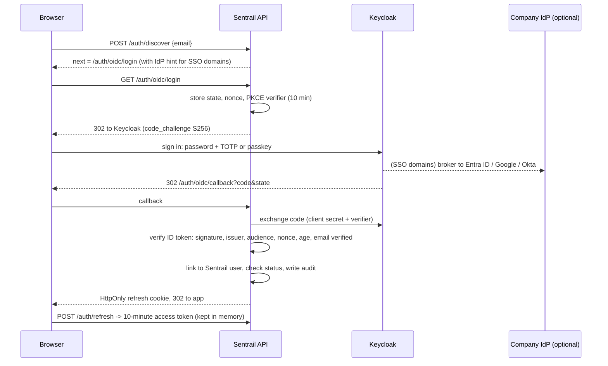

# Identity and sign-in

Sentrail uses **Keycloak** (open source, CNCF incubating project) as its identity provider over
OpenID Connect. Keycloak proves *who* someone is. Sentrail decides *what they can do*: roles,
permissions and tenants live in Sentrail's own database.

## Sign-in flow (backend-for-frontend)

The browser never sees Keycloak's tokens. Sentrail issues its own short sessions, so suspending a
user or changing their role takes effect on their next request.

## Two login types, one sign-in page

Everyone uses the same page: email, then whatever their account needs (company SSO, or password then
passkey or code). The email decides where they land:

| Login type | Lands in | Roles | Can see customer data |
|---|---|---|---|
| Platform (Sentrail staff, `org_id` empty) | Platform console | Platform owner, admin, support, auditor | Never. Enforced by a database trigger on role permissions |
| Organization (customers) | Their organization, shown under the app name | Organization admin, compliance officer, analyst, auditor, plus custom roles | Only their own organization's, through row-level security |

The roles for each type are seed data in the database; see [ROLES.md](ROLES.md).

## Who signs in how

| Person | How |
|---|---|
| Employee at an organization with a verified SSO domain | Their company IdP, brokered by Keycloak. Linked to their Sentrail account on first sign-in, only if the email is on that verified domain |
| Anyone else (external auditors, smaller organizations) | Keycloak password + TOTP or passkey. Keycloak emails a single-use setup link when they're invited |
| Platform master login | Local break-glass account (password + TOTP), works even if Keycloak is down. Organization users can't use local sign-in in Keycloak mode |

Accounts are never created on sign-in. An admin must invite each person first.

## Keycloak realm (`infra/keycloak/realm-sentrail.json`)

Imported on first start. It sets brute-force protection (5 failures), a 14-character password
policy with history, TOTP, passkeys (WebAuthn with user verification), 15-minute idle and 12-hour
maximum sessions, event logging, no self-registration, and two clients:

- `sentrail-web`: confidential client for sign-in, authorization code + PKCE only (no implicit or password grants).
- `sentrail-admin`: service account limited to `manage-users`, `view-users`, `query-users`, used to invite, disable and reset users.

Only the email address goes to Keycloak. Names and all compliance data stay encrypted in Sentrail.

**Two-factor is required for every Keycloak user** (Keycloak's own policy; the choose-it-yourself model below applies to local sign-in). (The per-organization "optional two-factor" setting applies to
Sentrail's own password sign-in, `AUTH_MODE=local` and the break-glass login; Keycloak enforces its own realm policy.)
Invited users get the `CONFIGURE_TOTP` required action
and can add a passkey. Because of this, `TRUST_IDP_MFA=true` by default. If you can't guarantee it
(for example a brokered IdP that doesn't enforce MFA), set it to `false` and configure an `amr` or
`acr` claim in Keycloak that proves MFA; Sentrail then rejects sign-ins without it.

## Adding a company's own IdP

1. In Keycloak, add an identity provider (OIDC or SAML) with an alias, such as `northwind-entra`.
   Set its first-broker-login flow to not create accounts automatically.
2. In Sentrail, the org admin calls `PUT /admin/sso` with the domain and alias, adds the returned TXT
   record at `_sentrail.<domain>`, then calls `POST /admin/sso/verify`.
3. From then on, emails on that domain go straight to the company IdP.

## Check after upgrading Keycloak

Realm import fields change between Keycloak versions. After a first start, confirm in the Keycloak
console that brute-force protection, the password policy, OTP policy and both clients match the
file. The compose file pins Keycloak 26.0; update the tag deliberately.

## Sign-in and sessions (access model v2, phase 2)

One `POST /auth/login` serves everybody; a successful sign-in answers with `route`:

| route | meaning (with `ACCESS_MODEL_V2` on) |
|---|---|
| `console` | platform staff (including owners) land in the platform console and can "enter" a tenant they are a member of |
| `tenant` | exactly one active membership: straight into that tenant |
| `picker` | several memberships: a session with **no tenant yet** (`scp = select`) that can only call `/me`, `/me/tenants` and `/session/*` |
| `no_access` | no membership and no platform role (the same limited session, with nothing to choose) |

With the flag off the route is `tenant` (the user's organization) or `console`, as before. `GET /me/tenants` lists the places a person can work;
`POST /session/tenant {tenant_id | null}` moves to another tenant (null = console) by ending the current session and starting a new one (new
session id, audited in both tenants' logs, `auth.tenant_switch`). Switching needs the flag; the old model has exactly one tenant per user.

**Access token claims:** `sub` user, `org`/`tid` active tenant (null in the console), `rid` role, `prid` platform role, `asid` access session
(phase 5), `sv` session version, `lmfa` time of the last second-factor check (epoch s), `scp` tenant | platform | select, `sid` session id.
A session is a refresh-token family bound to one tenant (`refresh_tokens.tenant_id/scope/last_mfa_at`); every request checks that the family is
still live, so signing out or switching ends the old access tokens at once, not after their 10 minutes.

**Request check order** (rbac): authenticated and current `session_version` -> tenant status (`active`/`trial` only) -> active membership
(flag on) -> permission -> plan feature -> step-up -> rate limits -> row-level security.

**Step-up.** Permissions flagged in the catalogue (`str.approve`, `screening.override`, `policy.edit`, `data.export`, `audit.export`,
`security.manage`, `apikeys.manage`, `platform.tenants.delete`, `platform.tenant.access`, `platform.owners.manage`, `platform.security.manage`) need
a second factor proved within `STEP_UP_WINDOW_MINUTES` (default 10). Otherwise the API answers **401 `{"error": "step_up_required"}`**; the web app
asks for a code, calls `POST /session/step-up {code | recovery_code}` and repeats the action. Refreshing a session never refreshes the step-up
clock. Sessions without a second factor are not challenged (they cannot answer); two-factor becomes mandatory for Tenant admins and
passkeys for owners in phase 6.

**Credential protection.** 10 failures in 15 minutes lock an (account, IP) pair for 15 minutes (`auth.locked`); every further failure on the
account answers slower (progressive delay, 0.25 s steps up to 1 s, `LOGIN_DELAY_STEP`); failures from all networks together lock the account for
everyone only at 50, so guessing from one network cannot lock the real owner out. Unknown emails are counted identically.

**Session hardening.** Cookies `sentrail_rt` (refresh) and `sentrail_dv` (device) are HttpOnly, Secure, SameSite=Strict, path `/auth`. Cookie-authenticated
writes (`/auth/refresh`, `/auth/logout`) need the header `X-Sentrail-CSRF: 1` and, when the browser sends an `Origin`, it must be the app (or the host
the API was reached on). A new session id starts at every sign-in and tenant switch. Idle and absolute timeouts are unchanged (tenant idle timeout,
platform maximum session hours).

**Notifications** (`app/services/notify.py`): new-device sign-in (device cookie not seen before, and the person has signed in before),
two-factor turned on or reset, role changed (and password changed, when a password-change route exists). Sent over SMTP when `SMTP_HOST` is set,
otherwise logged with a masked address. They never carry secrets.

**Audit actions:** `auth.signin`, `auth.signin_failed`, `auth.locked`, `auth.tenant_switch`, `auth.step_up`, `auth.step_up_failed`, `auth.signout`.

## Authorization and isolation (access model v2, phase 3)

**Every route declares what protects it.** `app/access/routes.py` reads each route's dependency tree and classifies it as permission,
API key, self-service (signed in, own account only: `/me*`, `/session/*`) or public (an explicit allowlist). A route that is none of these stops the
API from starting (`check_routes` at the end of `main.py`) and fails the unit test. The full map is generated into
[route-permissions.md](route-permissions.md) (`python -m scripts.gen_route_doc`; a test fails when it is stale).

**Row-level security knows who is acting** (migration 011). `pg.tx(org, actor=person)` sets `app.actor`; a policy lets a row through when its
tenant is the session's tenant **and** the actor has an active membership there (or a live owner access session). With no actor (API key,
sign-in lookups, scripts) the tenant scoping alone applies, as before. Platform mode additionally needs the actor to be active platform staff, and
never reaches case data. A person always reaches their own `users` row. A suspended or removed membership is therefore cut off in the database
itself, not only by the API.

**Restricted (need-to-know) cases.** `alerts.restricted`; a restricted case, its screening, its STR and its customer in searches are visible only to
holders of `cases.restricted.view` or people named on it (`case_access_grants`, `GET/POST/DELETE /cases/{id}/access`). Marking a case needs both
`cases.decide` and `cases.restricted.view` (`PUT /cases/{id}/restricted`, reason required). Everyone else gets 404, the queue and search skip it, and
the database enforces it (an analyst cannot read the STR directly either).

**Read auditing.** `case_viewed` (restricted cases: every view; ordinary cases: once per person per hour), `str_viewed` when an STR is read, plus the
existing `case_exported`. Restricting, un-restricting and naming people are audited with their reasons.

**Permissions per route** follow the catalogue ([permissions.md](permissions.md)): security settings and company sign-in need `security.manage`,
API keys `apikeys.manage`, revealing an email `users.pii.reveal`, tenant administration `platform.tenants.manage`. Old names still work as aliases
(logged) until the cut-over. The Tenant admin and Platform owner roles are locked in the database.

**Tests.** `test_isolation_e2e` calls every route that needs a sign-in as a Tenant admin of tenant A with tenant B's IDs (and as platform staff),
then proves B's data was neither returned, changed nor logged (`ISOLATION_NEGATIVE_CONTROL=1` switches row-level security off to prove the suite can
fail). `test_authorization_e2e` covers separation of duties, row-level security by actor, restricted cases, read auditing and the check order.
Background jobs register in `app/access/jobs.py` and join the isolation run (there are none yet).

## Tenant lifecycle (access model v2, phase 4)

`pending` -> `active` <-> `suspended` -> `deleted` (`trial` still exists for old rows).

| Step | How | What happens |
|---|---|---|
| Create | `POST /platform/orgs` (`platform.tenants.manage`) | slug validated (permanent, unique), tenant `pending`, its four roles (Tenant admin locked), the platform security baseline copied, audit entry in the tenant's log and the platform's, a 72-hour invitation for the first Tenant admin. With the new model, an email that already has an account gets a membership instead and the tenant is active at once. |
| Activate | the first admin accepts the invitation | password (or company sign-in), tenant becomes `active` (`tenant_activated`), and **two-factor is mandatory** for them (`users.mfa_mandatory`): until they set it up, only the setup screens answer. |
| Invite members | `POST /admin/invitations` | refused when active memberships already fill the plan (Starter 5, Professional 25, Enterprise unlimited); checked again when the invitation is accepted. Expired invitations (72 h) answer 410; platform support or an owner resends them (`POST /platform/orgs/{id}/users/{uid}/resend-invitation`). |
| Suspend / reactivate | `POST /platform/orgs/{id}/status {status, reason}` | suspended: nobody can sign in, every session ends, every API key is refused, data is kept. Only active/trial -> suspended and suspended -> active. Audited with the reason in both logs. |
| Delete | `POST /platform/orgs/{id}/delete {reason}` then a **second** Platform owner `POST /platform/approvals/{id}/approve` within 24 hours | marks the tenant `deleted`, ends sessions, revokes API keys and schedules the data removal after the retention period (`deletion_due_at`; the removal job arrives in phase 7). The requester can't approve (API and database), approvals expire after 24 hours, and `deny` is available to a second owner. |
| Replace a lost admin | `POST /platform/orgs/{id}/admin {email, reason}` | an existing member is promoted, anyone else invited for 72 hours; the reason is written to the tenant's log and the platform's (`tenant_admin_assigned`). |

Approvals (`GET /platform/approvals`) are the generic second-owner mechanism; phase 5 adds owner changes and loosening the security baseline to it.

## Owner access, approvals and break-glass (access model v2, phase 5)

**A Platform owner reaches a tenant's data only through an access session.** `POST /platform/orgs/{id}/access {reason}` (needs `platform.tenant.access`, a
step-up permission) follows the tenant's own setting, which its Tenant admins change under Security settings (`owner_access`, needs `security.manage`):

| Setting | What happens |
|---|---|
| `allow` (default) | the session starts at once |
| `require_approval` | a request waits up to 24 hours; one of the tenant's own Tenant admins approves or denies it (`GET /admin/access-requests`, `POST .../approve`, `.../deny`) |
| `deny` | refused, unless a **second owner** approved a recorded legal hold (`POST /platform/orgs/{id}/legal-hold`, approval flow below); the session is then flagged `legal_hold` |

A session lasts 60 minutes and can be extended once (`POST /platform/access/{id}/extend`); `DELETE /platform/access/{id}` (the owner or a colleague),
`DELETE /me/access-session` (from inside) and `DELETE /admin/access-requests/{id}` (the tenant) end it early. The owner then enters with
`POST /session/tenant {tenant_id}`: the token carries `asid`, and **every request re-checks the session is live** (when it expires, the next request answers
401 and the end is recorded). Inside, the owner acts with Tenant admin rights; they cannot approve an STR they drafted, change the tenant's `owner_access` setting
or decide on access requests. Every audit event they cause carries `access_session_id` in the tenant's log **and** is mirrored into the platform's (`tenant_action`).
Tenant admins are emailed when a session is requested, starts and ends; the web app shows a persistent banner with an "End access" button. Until the job runner
exists (phase 7), expired sessions are closed (and announced) the next time anyone touches access.

**Second-owner approvals** (`GET /platform/approvals`, `POST .../approve`, `.../deny`; the requester can never approve; requests expire after 24 hours):
deleting a tenant, placing or lifting a legal hold, adding an owner, changing, demoting or suspending an owner, and **loosening** the platform security baseline
(tightening applies at once). Nothing is applied until the second owner approves.

**Break-glass.** Exactly one sealed Platform owner account (`python -m scripts.create_break_glass`, database-enforced single account, platform only). Using it alerts every
other owner (email + `break_glass_used` in the platform log) and sets `must_rotate`: until its password is changed (`POST /me/password`) nothing else works. Changing a password
(`POST /me/password`, any user) ends all their sessions, issues a fresh one, and notifies them.

## Authentication enforcement (phase 6)

**Every stored security setting is enforced by the API**, and `tests/test_settings_enforcement_e2e.py` proves it (it also fails when a column is added to
`security_settings` or `platform_settings` without a proof). The three settings that were stored but never used are gone: `sso_enabled` (derived from the verified
domain), `oidc_issuer` and `oidc_client_id` (the identity provider lives in Keycloak).

**Company single sign-on (`GET/PUT /admin/sso`, Tenant admins, step-up).** A tenant sets its verified domain, Keycloak identity-provider alias, protocol (`oidc`
or `saml`, both brokered by Keycloak), a default role for new people and whether sign-in is *enforced*. When enforced, password sign-in is refused for every
member of that domain (the web app asks `/auth/discover` first and sends them to their provider); nothing is enforced until the domain is verified. First sign-in
creates a membership just in time with the default role (never a locked role), only for an address the provider has verified. One **emergency account** per tenant
(`PUT/DELETE /admin/sso/emergency`) keeps password + passkey sign-in so a broken provider can't lock a company out; it must be an active Tenant admin who already has a passkey, and setting it is audited.

**Passkeys (WebAuthn).** `/me/passkeys*` to register, list and remove (max 10; an owner can't remove their last passkey while the platform requires one),
`/auth/passkey` to sign in (as the second step after the password), `/session/step-up/options` for step-up. Challenges are single use and last 5 minutes; the sign
count is checked. Platform owners must have a passkey (`platform_staff_passkey_only`, default off until each owner has registered one) and until then can do
nothing but register one. **Tenant admins must use two-factor** (an authenticator app or a passkey); the platform's `passkeys_allowed` setting can switch passkeys off.
The relying party comes from `APP_URL` (override with `WEBAUTHN_RP_ID` / `WEBAUTHN_ORIGINS`).

**API keys.** Keys can expire, be limited to IP ranges and to a rate per minute, show `last_used_at`, and be rotated (`POST /admin/api-keys/{prefix}/rotate`: the new key
is shown once, the old one keeps working for 24 hours so the caller can switch over). An expired, revoked, out-of-range or over-rate key gets 401/403/429 and an audit entry.

## Governance and data controls (phase 7)

Evidence recipes for auditors are in [soc2-access-evidence.md](soc2-access-evidence.md).

**Background jobs.** `app/access/jobs.py` registers them; `python -m scripts.run_jobs` runs them once, `--loop` keeps running (the `worker` container in every compose file, every 5 minutes). One database lock keeps two runners apart; a job failing for one tenant is logged, recorded in `job_runs` and never stops the rest.
Tenant jobs: `dormant_sweep`, `review_cycle`, `audit_stream`, `expire_exports`. Global jobs: `platform_review_cycle`, `purge_deleted_tenants`, `housekeeping` (expired challenges and login states, ended owner access sessions). The isolation suite runs every tenant job for one tenant and proves another tenant's data is untouched.

**Dormant members.** `security_settings.dormant_days` (default 90, 30-365). A membership nobody has used for that long is suspended, its sessions end, and the Tenant admins are told. The last active Tenant admin and the SSO emergency login are never suspended. Signing in, switching into the tenant and being reactivated all count as activity.

**Access reviews** (`access.review`; owners for platform staff, `/platform/access-reviews*`). A review snapshots every active member; each person gets keep, change (to a role of the tenant, never the locked Tenant admin role) or remove (suspend). Nobody reviews themselves. Sign-off needs a decision for everyone, applies them in one transaction (the last Tenant admin can't be removed), and is audited per decision. The system opens a new review every `access_review_days` (default 90) and reminds weekly about an overdue one (30 days after opening). Owners can't be changed or removed through a review: that needs a second owner's approval.

**Audit export and streaming.** `POST /admin/audit/export` (`audit.export`) gives a signed JSON or CSV file through a single-use link. `PUT /admin/audit/stream` (Enterprise `audit_streaming`) delivers new events to the tenant's `https` endpoint, in order, at least once, signed with a secret shown once; https only, private addresses refused at set-up and again at every delivery; 50 failures in a row switch it off. Retention is the tenant's `retention_years` (platform minimum 5): the only thing that ever cuts the append-only log is removing a deleted tenant after that period.

**Export controls (I8).** Case, audit and tenant-data exports share one limit per person per hour (`export_limit_per_hour`, default 20, then 429), carry a watermark, and files are fetched once, within 15 minutes, by the person who asked (`GET /me/exports/{token}`); the stored copy is encrypted and deleted when fetched.

**Anomaly alerts (I9).** More than `anomaly_searches_per_hour` (100) searches or `anomaly_exports_per_hour` (10) exports by one person in an hour alerts the Tenant admins (audited `anomaly_alert`, once an hour per person and kind). A sign-in from a country the person has not used before alerts them when `alert_new_country` is on; the country comes from the header `COUNTRY_HEADER` (default `CF-IPCountry`) and is trusted only when `TRUST_COUNTRY_HEADER=true`, i.e. when a CDN or load balancer in front sets it and strips what clients send.

**SCIM 2.0 (Enterprise `scim`).** `/scim/v2/Users` and `/Groups` with a tenant admin's token (`POST /admin/scim/tokens`, shown once; the token fixes the tenant). Users are created without a password (they sign in through the company's identity provider) with the tenant's default role. `active: false` and DELETE **deprovision**: the membership is suspended and sessions end at once; nobody is deleted, and the last active Tenant admin can't be deprovisioned. Groups map to roles (`PUT /admin/scim/groups/{id}`, never the locked Tenant admin role): several groups give the role with the most permissions, no mapped group returns a person to the default role, and Tenant admins are never changed by groups.

**Offboarding.** `POST /admin/data-export` (`data.export`) gives the whole tenant (organization, people, roles, cases, STRs, screenings, settings, audit log with its chain result) as one signed file, without any secret. A deleted tenant keeps its data until `deletion_due_at`; then `purge_deleted_tenants` removes every row carrying the tenant's id (discovered from the schema, so a new table can't be forgotten), keeps people who also belong to another tenant (they lose only this membership), blanks the organization row (it stays as a tombstone so the slug is never reused), and writes `tenant_data_removed` into the platform log with the counts and the final hash of the tenant's audit chain.

## Admin screens and teams (phase 8)

**Who sees what.** Every screen hides what a role can't use, and the server refuses it anyway: `tests/test_roles_e2e.py` signs in as every built-in role and calls every permission-protected route (the allowed ones must open, every other one must answer 401/403), and `frontend/src/pages/Governance.test.tsx` checks the navigation and the "No access" page for each role (the role permissions come from `frontend/src/test/roles.fixture.json`, generated from the catalogue: `python -m scripts.gen_frontend_roles`).

| Who | Screens |
|---|---|
| Tenant admin | Users (with effective permissions), Roles (separation-of-duties warnings, preview as role), Security settings (including the governance settings and a full data export), Company sign-in, API keys (expiry, rotation), Access reviews, Platform access requests, Features, Audit log (signed exports), Teams (when switched on) |
| Platform owner | Organizations (create, suspend, reactivate, delete request, request access), Plans, Security baseline, Staff, Approvals, Tenant access sessions, Staff access review, Audit log |
| Platform support / auditor | Organizations (support), Tenant access sessions and the Audit log (auditor) |

**Effective permissions.** `GET /admin/users/{id}/effective-permissions` and `GET /admin/roles/{id}/effective` list what a person or role can do (each permission with its wording and whether it asks for a fresh second factor), the plan features that are on, and any separation-of-duties warnings.

**Preview as role.** On the Roles screen a Tenant admin can preview the app as another role: the navigation and screens show only what that role would see, a banner says so, and "Exit preview" returns. It changes the screens, never the server's decisions: every request still carries the admin's own permissions.

**Separation of duties.** `catalogue.SOD_CONFLICTS` lists permission pairs one role should not hold together (draft and approve STRs, manage users and decide cases, edit policy and override screening, and so on). Saving or listing a role returns a plain-language warning per conflict. It never blocks (a small team may have a reason); the locked Tenant admin role is exempt.

**Teams and queues (`TEAMS=true`, off by default).** A Tenant admin (`teams.manage`) defines teams and their members (`/admin/teams*`). An alert is placed in a team's queue (`PUT /cases/{id}/team`, `cases.decide`); members see their queues in `GET /me/teams` and `GET /alerts?team=...`. A queue only narrows what someone already sees: it never widens `cases.view` and never reaches a restricted case (row-level security still decides which alerts come back). A team must be made of active members of the tenant. With the flag off every team route answers 404 and the screens are hidden.
